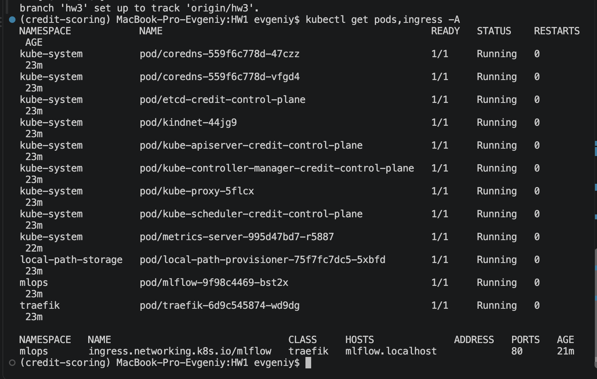
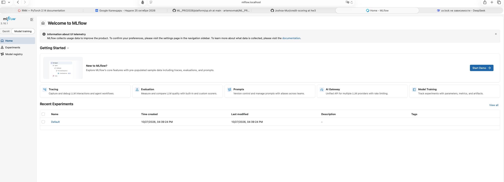
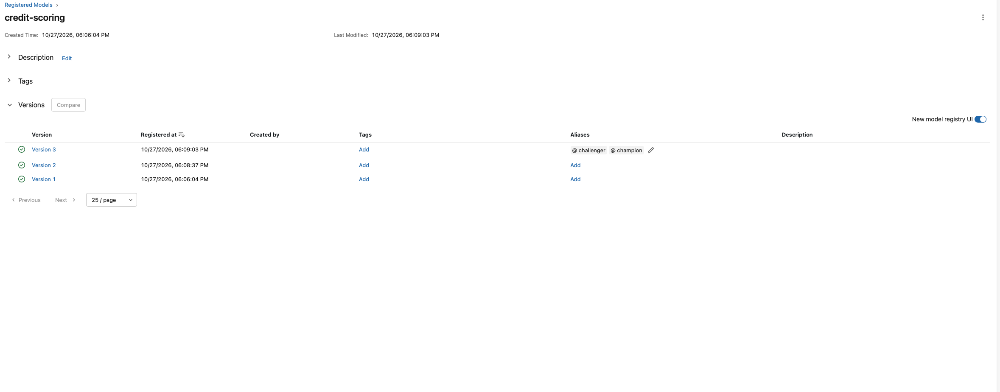
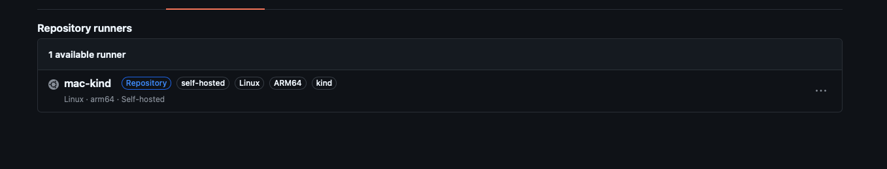
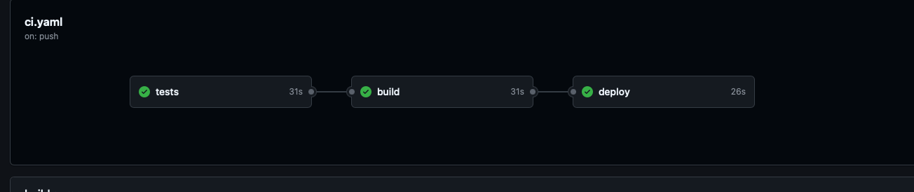
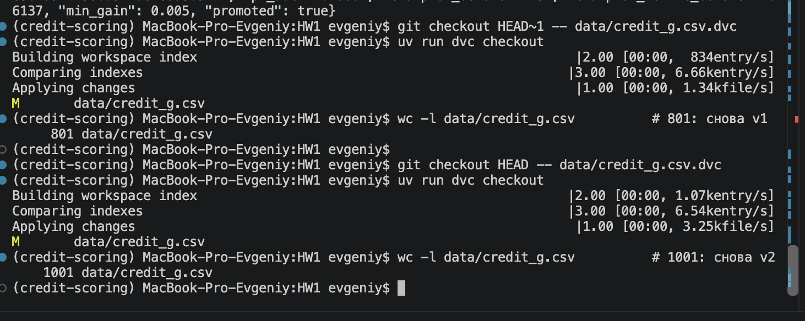
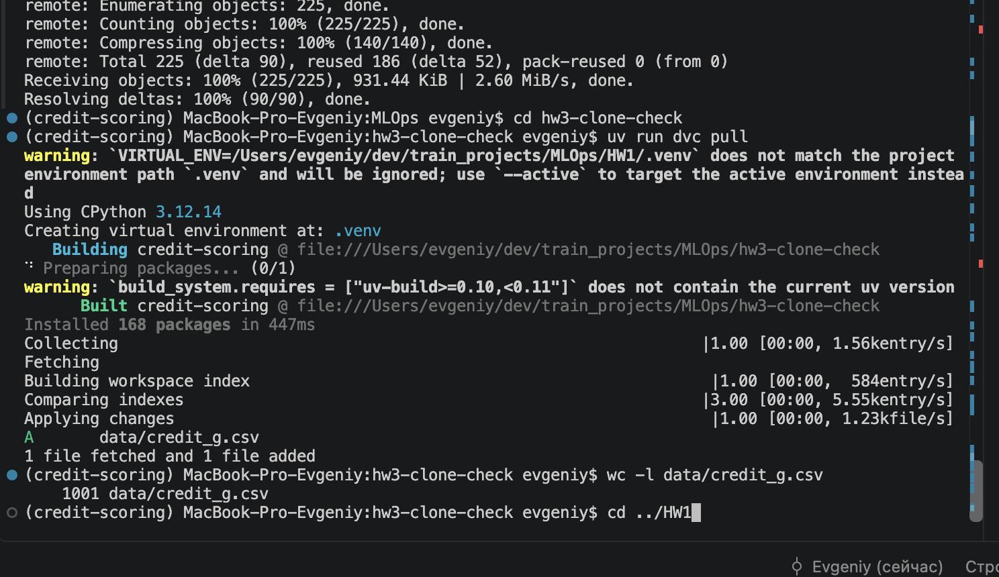
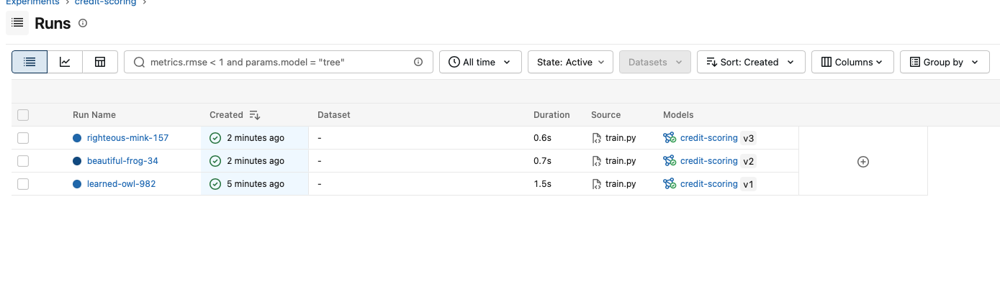
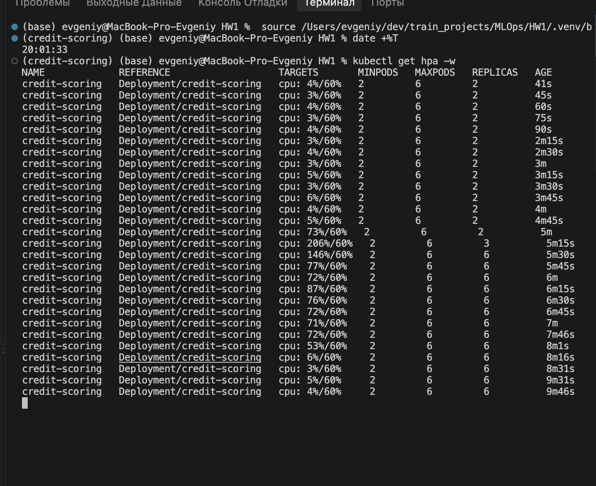
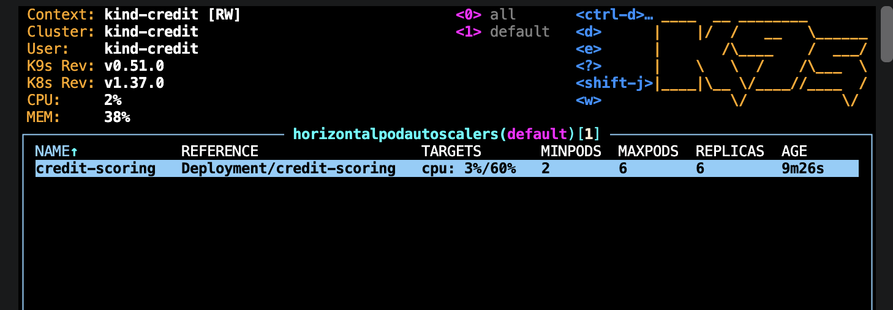

# Домашка 3: платформа в kind, реестр MLflow, CI/CD через self-hosted runner, DVC, HPA

Отчёты прошлых домашек: `REPORT_HW1.md`, `REPORT_HW2.md`. Работа шла в ветке `hw3` и попала в `main`
через PR #2: https://github.com/Joshoa-Mur/credit-scoring/pull/2 (в истории PR виден красный прогон и
починка следующим коммитом). Поломки п. 7 — отдельными коммитами прямо в `main`.

## Сводка: пункт → доказательство

| Пункт | Ссылка / скрин |
|---|---|
| 1. Платформа: `kubectl get pods,ingress -A` |  |
| 1. MLflow на http://mlflow.localhost в режиме Model training |  |
| 2. Model registry: версии и Aliases |  (после трёх запусков гейта; позже v4 на данных v2 забрала champion) |
| 2. Вывод трёх запусков с решением гейта | ниже, раздел «Гейт» |
| 2. Свой артефакт `pr_curve_confusion.png` | скрин TODO `docs/img/hw3/artifact.png` |
| 3. /health до и после отката, секунды | ниже, раздел «Откат модели» |
| 4. Зелёный прогон tests → build → deploy | в ветке: https://github.com/Joshoa-Mur/credit-scoring/actions/runs/40559445053 · в main после мержа PR #2: https://github.com/Joshoa-Mur/credit-scoring/actions/runs/40568862950 |
| 4. Runner name в логе deploy | скрин TODO `docs/img/hw3/runner-name.png` |
| 4. Settings → Actions → Runners |  · граф прогона:  |
| 5. `data/credit_g.csv.dvc` в репо | [data/credit_g.csv.dvc](data/credit_g.csv.dvc) |
| 5. `dvc diff`, checkout туда-обратно, `dvc pull` в чистом клоне |  , текст ниже; скрин `dvc push` TODO |
| 5. Два прогона MLflow с разными `data_md5` | скрин TODO `docs/img/hw3/data-md5.png` (Experiments, колонки data_md5 и pr_auc); список запусков:  |
| 6. HPA: реплики растут и падают, SuccessfulRescale, таблица locust |  , таблица и события ниже |
| 7. Три поломки: красный / зелёный | ниже, раздел «Три поломки» (все 6 ссылок) |

## 1. Платформа

`bash platform/up.sh` поднимает кластер `credit` из `platform/kind-config.yaml` (порт 80 ноутбука →
NodePort 30080), MLflow (`platform/mlflow.yaml`, все три обязательных флага на месте), Traefik
(helm, `platform/traefik-values.yaml`), metrics-server и Ingress `mlflow.localhost`. Ingress сервиса
(`scoring.localhost`) лежит в `k8s/ingress.yaml` и применяется из CI. Airflow, S3 и Prometheus/Grafana
не ставил: блоки D и E вне ДЗ, а DVC в п. 5 работает без S3 — экономия около 3 ГБ памяти.

## 2. Обучение, реестр и гейт

`src/credit_scoring/service/train.py`: CatBoost в sklearn Pipeline (как в ноутбуке ДЗ 1), данные из
`data/credit_g.csv` под DVC, порог по минимуму стоимости ошибок на OOF (FN = 5, FP = 1). В MLflow
пишутся параметры (в том числе `data_md5`), метрики `pr_auc`, `roc_auc`, `test_cost`, `threshold`,
`metadata.json` с признаками и порогом, свой артефакт `pr_curve_confusion.png` (PR-кривая и матрица
ошибок при выбранном пороге), модель регистрируется как `credit-scoring`.

**Метрика гейта и запас.** Гейт смотрит на PR-AUC по классу bad. Плохих заёмщиков всего 30%, и
пропустить такого в 5 раз дороже, чем зря отказать хорошему, поэтому мне важно, как модель ловит именно
bad, а ROC-AUC на таком дисбалансе выглядит слишком оптимистично. Запас `MIN_GAIN = 0.005`, потому что
тест маленький (160–200 клиентов) и разница в тысячные — это шум разбиения, а не настоящее улучшение.

### Гейт: три запуска (данные v1, 800 клиентов, `data_md5 = bc3eb227…`)

| Запуск | ITERATIONS | Версия | PR-AUC | Champion до (PR-AUC) | Решение |
|---|---|---|---|---|---|
| 1 | 100 | v1 | 0.5523 | — | champion (его не было) |
| 2 | 50 | v2 | 0.5302 | v1 (0.5523) | только challenger |
| 3 | 300 | v3 | 0.6137 | v1 (0.5523) | champion: +0.061 > 0.005 |

```
{"run_id": "202bbf53129043539d3cef4d94e0fb39", "version": "1", "iterations": 100, "data_md5": "bc3eb227b09c7c6f989ea084e7220fbc", "pr_auc": 0.5523, "champion_before": null, "champion_metric_before": null, "min_gain": 0.005, "promoted": true}
{"run_id": "6c79b997ef904effb963404bb373f564", "version": "2", "iterations": 50, "data_md5": "bc3eb227b09c7c6f989ea084e7220fbc", "pr_auc": 0.5302, "champion_before": "1", "champion_metric_before": 0.5523, "min_gain": 0.005, "promoted": false}
{"run_id": "30364f09be204ebebf689cecca3e59ba", "version": "3", "iterations": 300, "data_md5": "bc3eb227b09c7c6f989ea084e7220fbc", "pr_auc": 0.6137, "champion_before": "1", "champion_metric_before": 0.5523, "min_gain": 0.005, "promoted": true}
```

## 3. Сервис по алиасу и откат модели

`src/credit_scoring/service/model_store.py`: если задан `MODEL_NAME`, сервис спрашивает реестр, какая
версия висит на алиасе `MODEL_ALIAS` (по умолчанию `champion`), грузит её и её `metadata.json`;
без `MODEL_NAME` грузит файл `models/credit_model.joblib`, поэтому тесты в CI идут без MLflow.
ConfigMap задаёт `MLFLOW_TRACKING_URI=http://mlflow.mlops:5000`, `MODEL_NAME=credit-scoring`,
`MODEL_ALIAS=champion`. Поле `model_path` в `/health` — запасной путь для режима без реестра.

### Откат модели

До отката:
```
{"status":"ok","model_version":"credit-scoring-v3","model_path":"/app/models/credit_model.joblib","log_level":"INFO"}
```
В UI перевесил `champion` с v3 на v1 (20:01:33), затем `kubectl rollout restart deploy/credit-scoring`,
`rollout status`, `curl http://scoring.localhost/health` (20:02:09):
```
{"status":"ok","model_version":"credit-scoring-v1","model_path":"/app/models/credit_model.joblib","log_level":"INFO"}
```
**От клика в UI до ответа старой версии — 36 секунд**, без пересборки образа. Потом вернул champion на v3.

## 4. CI/CD в свой кластер

`tests` и `build` идут в облаке GitHub, `deploy` — на self-hosted runner `mac-kind` в Docker на моём
маке (`runs-on: [self-hosted, kind]`). Runner запущен в сети `kind` с сокетом Docker:

```bash
docker run -d --name gh-runner --restart unless-stopped --network kind \
  -v /var/run/docker.sock:/var/run/docker.sock \
  -e REPO_URL=https://github.com/Joshoa-Mur/credit-scoring -e RUNNER_TOKEN=*** \
  -e RUNNER_NAME=mac-kind -e LABELS=kind myoung34/github-runner:latest
```

Особенность моей машины: Mac на Apple Silicon, кластер kind arm64, а облачный runner собирает amd64.
Поэтому build собирает образ под `linux/arm64` через QEMU (`provenance: false`, иначе лишний индекс
ломает загрузку в kind), а deploy грузит образ в узел через `docker save --platform linux/arm64` +
`kind load image-archive` (обычный `kind load docker-image` падает на образах из containerd Docker Desktop).

Секрет: `kubectl create secret ... --dry-run=client -o yaml | kubectl apply -f -`.
Smoke через Ingress (`http://credit-control-plane:30080`, `Host: scoring.localhost`) проверяет три вещи:
1. в `/health` версия вида `credit-scoring-vN` — модель пришла из реестра;
2. `score` на `request.json` лежит в [0, 1];
3. в `predictions` ровно одна строка с `request_id` из ответа.

Безопасность: включено Require approval for all external contributors. После сдачи runner выключу:
`docker rm -f gh-runner` и Remove runner в настройках.

## 5. Версии данных в DVC

Датасет раньше грузился на лету через `fetch_openml("credit-g")`; выгрузил его в `data/credit_g.csv`.
Remote — папка `../dvc-storage`.

- **v1** — первые 800 клиентов («ранняя выгрузка»), md5 `bc3eb227b09c7c6f989ea084e7220fbc`.
- **v2** — все 1000 клиентов («новый срез»), md5 `ac05ce3bfd911258bd37fde1e8a3051f`.

В German Credit нет дублей и пропусков, поэтому вторую версию сделал добавлением среза, а не чисткой.

- `dvc diff HEAD~1` → `Modified: data/credit_g.csv`, `files summary: 1 modified`.
- Откат: `git checkout HEAD~1 -- data/credit_g.csv.dvc && dvc checkout` → 801 строка; обратно → 1001.
- Чистый клон ветки в соседнюю папку, `uv run dvc pull` → `A data/credit_g.csv`, `1 file fetched and 1 file added`, 1001 строка.
- Четвёртый запуск обучения на v2: версия v4, `data_md5 = ac05ce3b…`, PR-AUC 0.6664 → прошла гейт (была 0.6137 у v3).
  Оговорка: v3 и v4 оценены на разных тестовых выборках (160 и 200 клиентов), так что прирост
  частично объясняется самими данными, это не строгое сравнение моделей.

## 6. HPA

`k8s/hpa.yaml`: 2–6 реплик, цель 60% CPU от `requests.cpu = 100m`. Нагрузка — `locustfile.py`
(POST `/v1/predict` через Ingress), замер одной командой `bash scripts/hpa_bench.sh`.

Прогоны подряд: 10 пользователей 3 мин, 30 — 3 мин, 60 — 4 мин, паузы 30 с; раз в 15 с снимались
`kubectl get hpa` и `kubectl top pods` (`hpa-bench/watch.log`).

| Пользователи | Реплики | p95, мс | p99, мс | req/s | Ошибки | CPU на под (top) | % от request |
|---|---|---|---|---|---|---|---|
| 10 | 2 → 4 → 6 | 7 | 11 | 75 | 0 из 13 481 | ~72m на 6 подах (пик 227m на 2) | 71–80% |
| 30 | 6 | 8 | 11 | 227 | 2 из 40 747 | ~220m | 214–237% |
| 60 | 6 | 21 | 67 | 441 | 1 из 105 504 | ~540m | 515–651% |

Хронология первого прогона (старт 21:58:04): CPU 207% на 2 подах в 21:58:50 → 4 реплики в 21:59:05
(~60 с от старта) → 6 реплик в 21:59:20 (~75 с). Дальше упор в `maxReplicas = 6`: на 30 и 60
пользователях подам нужно в 3–9 раз больше CPU, чем запрошено, расти уже некуда — растёт задержка
(p95 7 → 8 → 21 мс, p99 до 67 мс). Нагрузка кончилась в 22:09:28, CPU упал до 3–4% к 22:09:58, а реплики
ушли 6 → 2 только в 22:14:46 — через ~5 минут (окно стабилизации scale-down).

События `kubectl describe hpa credit-scoring`:
```
Normal  SuccessfulRescale  27m                horizontal-pod-autoscaler  New size: 3; reason: cpu resource utilization (percentage of request) above target
Normal  SuccessfulRescale  16m                horizontal-pod-autoscaler  New size: 4; reason: cpu resource utilization (percentage of request) above target
Normal  SuccessfulRescale  16m (x2 over 27m)  horizontal-pod-autoscaler  New size: 6; reason: cpu resource utilization (percentage of request) above target
Normal  SuccessfulRescale  29s (x2 over 19m)  horizontal-pod-autoscaler  New size: 2; reason: All metrics below target
```

**requests до и после.** До: `cpu 100m, memory 256Mi`. Память пода почти не зависит от нагрузки:
~205–218 МиБ в покое, максимум 226 МиБ под 60 пользователями. 226 МиБ + треть запаса ≈ 300 МиБ, то есть
у меня запрос не завышен, как в примере задания, а наоборот впритык (под занимал до 88% запроса).
После: `memory: 300Mi`. CPU-запрос 100m оставил: это база, от которой HPA считает проценты, а в покое
под тратит 3–4m.

## 7. Три поломки

Каждая — отдельный коммит в `main`, починка — следующим коммитом.

| Поломка | Красный | Зелёный |
|---|---|---|
| 1. Модели нет в реестре (`MODEL_ALIAS: prod`) | https://github.com/Joshoa-Mur/credit-scoring/actions/runs/40571117994 | https://github.com/Joshoa-Mur/credit-scoring/actions/runs/40572932526 |
| 2. Runner не видит кластер (`KIND_CLUSTER: credit-typo`) | https://github.com/Joshoa-Mur/credit-scoring/actions/runs/40573314861 | https://github.com/Joshoa-Mur/credit-scoring/actions/runs/40573737102 |
| 3. Ingress мимо (`host: credit.localhost`) | https://github.com/Joshoa-Mur/credit-scoring/actions/runs/40574370280 | https://github.com/Joshoa-Mur/credit-scoring/actions/runs/40575184957 |

**1. Модели нет в реестре.** Упал шаг «сервис»: `rollout status` повис на
`1 out of 2 new replicas have been updated...` и закончился `error: timed out waiting for the condition`,
smoke не запускался. В «диагностике» новый под `0/1 CrashLoopBackOff`, 5 рестартов за 3 минуты, а два
старых — `1/1 Running`, то есть сервис продолжал отвечать прежней версией. Лог упавшего пода
(`kubectl logs <под> --previous`) называет причину прямо:
`RestException: INVALID_PARAMETER_VALUE: Registered model alias prod not found.` →
`Application startup failed. Exiting.` По нему ясно, что смотреть надо `MODEL_ALIAS` в ConfigMap.

**2. Runner не видит кластер.** Упал первый же шаг деплоя «kind, kubectl и доступ к кластеру».
Строкой выше лог печатает `runner: mac-kind (aarch64)` — runner жив и взял задачу, а затем:
`ERROR: could not locate any control plane nodes for cluster named 'credit-typo'`. Значит, дело не в
runner'е и не в сети, а в имени кластера: `kind get clusters` на машине показывает `credit`.

**3. Ingress мимо.** Шаги «БД» и «сервис» зелёные, поды Ready — сервис здоров. Упал smoke:
`health: попытка 1..10 не прошла, ждём` и `exit code 1`. Раз поды живы, а через Ingress не достучаться
ни разу, сломан маршрут. В «диагностике» `kubectl get ingress -A` показывает у `scoring-service`
хост `credit.localhost`, а smoke шлёт `Host: scoring.localhost` — Traefik не находит правила и
отвечает 404.

## Восемь вопросов

**1. Почему tests и build в облаке, а deploy нет?** Тестам и сборке нужен только код и GHCR, это есть
в облаке. А kind живёт у меня на ноутбуке за NAT, и облачный runner до него просто не достучится.
Другие варианты: Argo CD / Flux внутри кластера, который сам тянет манифесты из git, или туннель/VPN
до API кластера. Runner проще всего: он сам ходит к GitHub, ничего наружу открывать не надо.

**2. Зачем `--network kind`, сокет Docker и `--group-add 0`?** `--network kind` — чтобы runner видел
узел `credit-control-plane` (API кластера и NodePort для smoke), без неё падает первый же kubectl.
Сокет Docker — для `docker pull` и `kind load`, без него `Cannot connect to the Docker daemon`.
`--group-add 0` даёт доступ к сокету не-root пользователю; у меня runner работает от root, поэтому
флаг не понадобился, иначе было бы `permission denied`.

**3. Зачем `--dry-run=client -o yaml | kubectl apply` вместо `create secret`?** `create` срабатывает
только один раз, на втором деплое падает с `AlreadyExists`. Через `apply` секрет создаётся, если его
нет, и обновляется, если поменялся пароль.

**4. Чем challenger отличается от champion?** Challenger — последняя обученная версия, champion — та,
что реально обслуживает сервис, и получает его только прошедшая гейт. Сервис просит алиас, чтобы
менять модель без пересборки и правки конфига: перевесил алиас, перезапустил поды — у меня откат занял
36 секунд. `rollout undo` откатывает код и образ, а модель не трогает.

**5. Что будет, если модели ещё нет?** Сервис на старте не находит алиас и падает:
`Registered model alias prod not found` → `Application startup failed` (проверил поломкой 1).
В k9s под в `CrashLoopBackOff` (у меня 5 рестартов за 3 минуты), в CI шаг «сервис» падает с
`timed out waiting for the condition`. Старые поды при этом продолжают работать.

**6. Путь от браузера до MLflow.** Браузер → `127.0.0.1:80` → проброс Docker в узел kind на 30080 →
Traefik → Ingress по хосту `mlflow.localhost` → Service `mlflow:5000` в `mlops` → под MLflow.
`--allowed-hosts` нужен, потому что MLflow проверяет заголовок Host и чужим отвечает 403,
`--cors-allowed-origins` — чтобы UI мог ходить в API. Порт 80 — это проброс порта контейнера-узла,
его нельзя добавить к уже запущенному контейнеру, только пересоздать кластер.

**7. Сколько реплик должен был выставить HPA?** Формула: ceil(реплики × загрузка / 60%).
73% на 2 подах → ceil(2 × 73/60) = 3, HPA поставил 3. 227% на 4 подах → 16, но потолок 6, поставил 6.
На 60 пользователях 540% на 6 подах → «хотелось бы» 54, стояло 6. Вниз реплики ушли через ~5 минут
после спада нагрузки (6 → 2 в 22:14:46): это окно стабилизации, чтобы HPA не дёргался на каждом провале.

**8. Что в git, а что в DVC?** В git — код, манифесты и маленький файл `data/credit_g.csv.dvc` с md5
данных, а сами данные лежат в хранилище DVC (`../dvc-storage`). Чтобы восстановить данные версии N:
в MLflow берём у версии N `data_md5`, находим коммит, где в `.dvc` этот md5
(`git log -p data/credit_g.csv.dvc`), делаем `git checkout <коммит> -- data/credit_g.csv.dvc` и `dvc pull`.

## Журнал проблем


### 1. Решение: облегчённая платформа
- **Что:** из семинарской `platform/` убрали Airflow, S3 (RustFS) и Prometheus/Grafana.
- **Почему:** п. 5 ДЗ — DVC «пока без S3» (remote в локальной папке); блоки D и E вне ДЗ; экономия ~3 ГБ памяти Docker Desktop.
- **Взамен:** в `up.sh` сразу ставится metrics-server (`--kubelet-insecure-tls`) для HPA.


### 2. Датасета не было файлом
- **Что:** для DVC нужен файл, а ноутбуки грузили German Credit на лету через `fetch_openml("credit-g")`.
- **Как нашли:** при подготовке к `dvc add` — в репо нет ни `data/`, ни CSV.
- **Починка:** выгрузили `fetch_openml(...).frame` в `data/credit_g.csv` (1000 строк + заголовок); `train.py` читает CSV, а не openml, поэтому `data_md5` совпадает с md5 в `.dvc`.

### 53 CatBoost в Pipeline и формат сохранения в MLflow
- **Что:** на семинаре модель сохранялась в формате skops (`skops_trusted_types`), skops сериализует только явно доверенные типы и не рассчитан на объекты CatBoost внутри sklearn Pipeline; разбираться с этим не стали.
- **Починка:** `mlflow.sklearn.log_model(..., serialization_format=SERIALIZATION_FORMAT_CLOUDPICKLE)`. MLflow пишет предупреждение про pickle — это ожидаемо, модели грузим только из своего реестра.

### 4. После возврата champion на v3 сервис всё ещё отдавал v1
- **Что:** вернули `champion` на v3 в UI, сделали `rollout restart`, а `/health` показал `credit-scoring-v1`.
- **Как нашли:** проверили алиас через API MLflow:
  `curl "http://mlflow.localhost/api/2.0/mlflow/registered-models/alias?name=credit-scoring&alias=champion"` → `"version": "3"`. Реестр в порядке, значит поды стартовали раньше, чем перевес сохранился в UI.
- **Причина:** сервис читает алиас только один раз, при старте пода (в `lifespan`). Рестарт ушёл до сохранения в UI.
- **Починка:** ещё раз `kubectl rollout restart` → `credit-scoring-v3`. Вывод: сначала Save в UI, потом рестарт.
